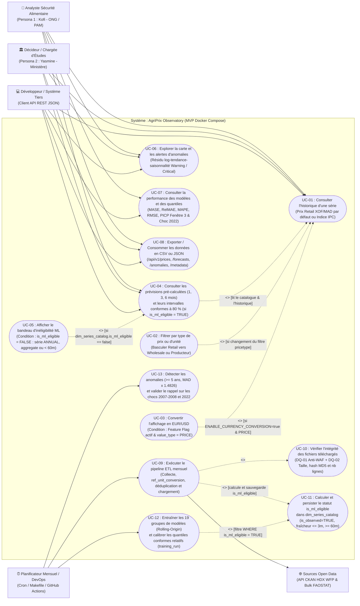

# Diagramme 01 — Cas d'utilisation (*Use Case Diagram*)

> **Termes techniques introduits dans ce document (en une phrase simple)** :
> - **Diagramme de cas d'utilisation (*Use Case Diagram*)** : Un schéma UML qui représente ce que le système permet de faire du point de vue de ses acteurs externes (humains ou systèmes tiers), sans entrer dans les détails techniques internes.
> - **Relation `<<include>>` (Inclusion obligatoire)** : Une flèche en pointillés signifiant que le cas d'utilisation principal exécute **systématiquement** le sous-cas pointé lors de son exécution.
> - **Relation `<<extend>>` (Extension conditionnelle)** : Une flèche en pointillés pointant vers le cas principal, signifiant qu'un comportement optionnel vient **compléter** le cas de base uniquement sous une condition précise.

---

## 1. Diagramme Mermaid (Rendu natif GitHub)

---

## 2. Comment lire ce diagramme ?

1. **Quatre acteurs** interagissent avec le système :
   - **L'Analyste (`Kofi`)** et **la Décideuse (`Yasmine`)** utilisent l'interface visuelle Streamlit (qui consomme l'API).
   - **Le Développeur / Système Tiers (`Client API REST JSON`)** interroge directement les endpoints `/api/v1/*` de FastAPI pour intégrer nos séries, prévisions ou alertes dans ses propres notebooks ou outils externes.
   - **Le Planificateur Mensuel / DevOps** exécute les jobs batch (`UC-09`, `UC-12`, `UC-13`).
2. **Distinction claire entre le calcul batch (`UC-11`) et la lecture temps réel (`UC-04` / `UC-05`)** :
   - C'est uniquement lors de l'ETL (`UC-09`) que `UC-11` parcourt tout l'historique pour **calculer et persister** le booléen `is_ml_eligible` dans `dim_series_catalog` (utilisé ensuite par l'entraînement `UC-12`).
   - Lorsqu'un utilisateur consulte une série (`UC-04`), l'API **ne recalcule jamais** l'algorithme d'éligibilité : elle lit simplement le booléen pré-calculé `dim_series_catalog.is_ml_eligible`, et déclenche l'extension `UC-05` (bandeau explicatif) si ce booléen vaut `FALSE`.

---

## 3. Deux questions qu'un recruteur pourrait poser sur ce diagramme

### Question 1 : *« Pourquoi avoir retiré le lien `<<include>>` entre `UC-04 (Consulter les prévisions)` et `UC-11 (Calculer l'éligibilité ML)` ? »*
> **Réponse conseillée** :
> « Parce que recalculer la continuité sur 60 mois et le nombre maximal de mois manquants consécutifs à chaque requête HTTP d'un utilisateur gaspillerait du CPU et violerait la séparation entre le pipeline batch (ETL) et la couche de service (API). L'éligibilité ML d'une série ne change qu'une fois par mois lors de l'ingestion de nouvelles observations : c'est donc `UC-09 (ETL)` qui inclut `UC-11` pour matérialiser `is_ml_eligible` et `ineligibility_reason` dans la table `dim_series_catalog`. En lecture (`UC-04`), l'API se contente d'une lecture indexée en $O(1)$ de cette colonne, et `UC-05` affiche le bandeau d'avertissement si `is_ml_eligible == FALSE`. »

### Question 2 : *« Pourquoi avoir ajouté l'acteur "Développeur / Système Tiers" en plus de l'Analyste et du Décideur ? »*
> **Réponse conseillée** :
> « Parce que l'un des apports majeurs d'AgriPrix Observatory par rapport aux portails existants (identifié dans notre étude de l'existant) est d'exposer une **API REST publique documentée sous OpenAPI/Swagger** (`/api/v1/prices`, `/forecasts`, `/anomalies`, `/metadata`). Un data scientist d'une ONG ou un système d'alerte précoce tiers peut consommer directement nos prévisions JSON sans passer par le dashboard Streamlit. Modéliser cet acteur justifie nos exigences non fonctionnelles propres à l'API : pagination, validation `Pydantic`, limitation de débit (`60 req/min/IP`) et compte PostgreSQL en lecture seule. »
