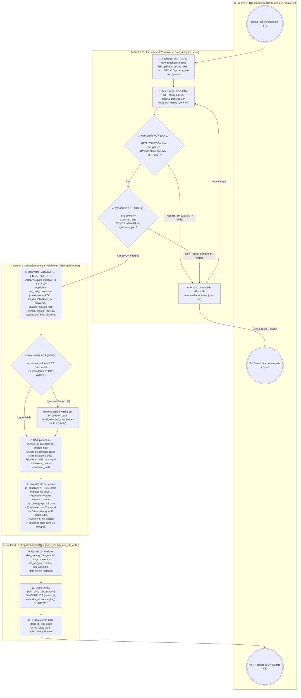
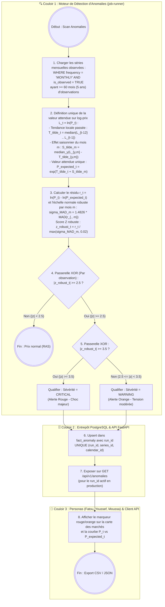

# Diagramme 02 — Processus métier BPMN (*Business Process Model and Notation*)

> **Termes techniques introduits dans ce document (en une phrase simple)** :
> - **BPMN 2.0 (*Business Process Model and Notation*)** : La norme internationale (ISO/IEC 19510) de modélisation graphique des processus métier, utilisant des **couloirs de nage (*swimlanes*)** par acteur/composant, des **losanges (*gateways*)** pour les décisions et des **cercles** pour les événements.
> - **MASE (*Mean Absolute Scaled Error*) vs `RelMAE` (*Relative MAE*)** : Deux métriques d'évaluation : le vrai **MASE** (Hyndman & Koehler) divise l'erreur de test par l'erreur saisonnière *in-sample* ($|y_t - y_{t-12}|$ sur le train), tandis que le **`RelMAE`** divise l'erreur de test du modèle à l'horizon $h$ par l'erreur de test de la baseline naïve saisonnière sur la même fenêtre.
> - **Facteur de consistance normale du MAD ($1{,}4826$)** : La constante mathématique ($\frac{1}{\Phi^{-1}(0{,}75)} \approx 1{,}4826$) par laquelle on multiplie l'écart absolu médian (**MAD**) pour qu'il soit directement comparable à un écart-type ($\sigma$) tout en restant insensible aux valeurs extrêmes passées.

---

## 1. Note sur la limite d'outil Mermaid pour BPMN 2.0

La norme **BPMN 2.0** native repose sur des fichiers XML (`.bpmn`). Comme **GitHub** ne rend pas le XML BPMN mais affiche nativement **Mermaid**, nous représentons la sémantique BPMN 2.0 via un `flowchart` structuré en **couloirs de responsabilité (`subgraph`)**, **événements de début/fin (`((("...")))`)** et **passerelles exclusives XOR (`{"... ?"}`)**.

---

## 2. Processus 1 — Ingestion, contrôle d'intégrité anti-troncature et validation des données (ETL)

---

## 3. Processus 2 — Génération d'une prévision multi-horizons ($h \in \{1, 3, 6\}$), sélection sur Fenêtres 1–2 et rapport final sur Fenêtre 3

```mermaid
flowchart TB
    subgraph LaneOrch ["⚙️ Couloir 1 : Orchestrateur ML (make train / job-runner)"]
        StartML((("Début : Campagne ML")))
        InitRun["1. Créer l'enregistrement training_run<br/>(run_timestamp, max_data_date, git_sha, mlflow_parent_run_id)"]
        SelectEligible["2. Sélectionner dans dim_series_catalog + fact_price_observation :<br/>WHERE is_ml_eligible = TRUE AND is_observed = TRUE<br/>-> 738 séries retenues (737 Retail UEMOA + 1 IPC Maroc)"]
        GroupPanel["3. Regrouper dans les 19 groupes (country_iso3, commodity_group)<br/>(18 groupes UEMOA + 1 groupe MAR CPI_Food)<br/>Extraire le segment continu récent (60..120 mois) en laissant les trous à NaN"]
    end

    subgraph LaneFeatureSplit ["📐 Couloir 2 : Découpage Temporel Commun & Ingénierie des Variables (Sans Imputation)"]
        SharedCutoff["4. Fixer les dates de coupure calendaires communes T_cutoff :<br/>- Validation W1 (Choc 2022 : T=2021-12, 671 séries testables >=24m / 605 >=36m)<br/>- Validation W2 (Stabilisation : T=2024-06, 738 séries testables)<br/>- Test Final Hold-out W3 (Récente : T=2025-08, 738 séries testables)"]
        BuildFeatures["5. Construire les features strictement causales (<= T_cutoff) :<br/>Lags (t-1..t-12), Moyennes glissantes (min_periods=1), Sin/Cos mois,<br/>market_code, commodity_code (trous laissés à NaN pour LightGBM)"]
    end

    subgraph LaneModelCalib ["🧠 Couloir 3 : Sélection du Champion (Fenêtres 1–2), Test Final (Fenêtre 3) & Quantiles Conformes"]
        TrainVal["6. Pour h in {1, 3, 6}, entraîner et évaluer sur Validation (W1 & W2) :<br/>1) SeasonalNaive (t-12) | 2) Ridge_Seasonal / SARIMA | 3) LightGBM_Global<br/>Calculer vrai MASE (dénominateur in-sample t-12) et RelMAE_h = MAE_model / MAE_naive"]
        EvalGate{"7. Passerelle XOR (Sur Fenêtres 1–2 uniquement) :<br/>RelMAE_h médian LightGBM < 1.0<br/>ET MASE médian < MASE Ridge ?"}
        SelectLGBM["Désigner LightGBM_Global comme<br/>champion du groupe pour l'horizon h"]
        SelectFallback["Activer le Fallback : Désigner Ridge_Seasonal<br/>ou SeasonalNaive comme champion pour h"]
        EvalTestW3["8. Évaluer une seule fois (sans retouche) les modèles et le champion<br/>sur la Fenêtre 3 (Hold-out Test 2025-2026) + Calibrer q_rel_10 et q_rel_90<br/>Mesurer PICP_80 sur W3 (régime récent) et sur W1 (choc 2022)"]
        PredictFuture["9. Ré-entraîner le champion jusqu'à max_data_date<br/>Prédire t+1, t+3, t+6 + intervalles [y_hat*(1+q_rel_10), y_hat*(1+q_rel_90)]"]
    end

    subgraph LaneStorageML ["📊 Couloir 4 : Serveur MLflow (mlflow_db) & Entrepôt PostgreSQL (agriprix_dw)"]
        LogMLflow["10. Enregistrer exactement 57 runs MLflow (19 groupes x 3 familles)<br/>rattachés au run parent (58 runs au total)"]
        SaveDB["11. Sauvegarder avec run_id dans fact_conformal_quantiles,<br/>fact_model_metrics_by_series et fact_forecast (2 214 prévisions)"]
        EndML((("Fin : Prévisions versionnées")))
    end

    StartML --> InitRun --> SelectEligible --> GroupPanel --> SharedCutoff --> BuildFeatures --> TrainVal --> EvalGate
    EvalGate -- "Oui (Bat les baselines sur W1-W2)" --> SelectLGBM
    EvalGate -- "Non" --> SelectFallback
    SelectLGBM --> EvalTestW3
    SelectFallback --> EvalTestW3
    EvalTestW3 --> PredictFuture --> LogMLflow --> SaveDB --> EndML
```

---

## 4. Processus 3 — Détection mensuelle d'anomalies (Résidu log-tendance-saisonnalité sur $\ge 5\text{ ans}$, $\text{MAD} \times 1{,}4826$)

> **Note d'architecture (Séparation Production vs CI)** : La validation historique du détecteur sur le catalogue élargi de chocs documentés fixés *a priori* (`2007–2008`, `2012 Crise sahélienne`, `2020 COVID-19`, `2022 Inflation/Ukraine`, `2023–2024 Sanctions Niger`) ne bloque **pas** le pipeline mensuel de production (car l'historique passé ne change pas chaque mois). Elle est exécutée automatiquement dans la **suite de tests d'intégration de la CI (`pytest`)** qui produit un rapport de rappel événement par événement et vérifie le seuil documenté ($\ge 80\%$ des crises détectées).

---

## 5. Comment lire ces diagrammes ?

1. **Dans le Processus 1 (ETL)**, remarquez les **deux passerelles d'intégrité (`3. DQ-01` anti-WAF et `4. DQ-02` taille/MD5/lignes)** ainsi que l'application de `ref_unit_conversion` et de la règle de collision (étape 7).
2. **Dans le Processus 2 (ML)**, l'étape 7 montre que le **choix du modèle champion se fait exclusivement sur les Fenêtres de validation 1 et 2**, tandis que l'étape 8 évalue une seule fois le modèle retenu sur la **Fenêtre 3 (*Hold-out Test*)**, évitant tout sur-apprentissage du choix de modèle sur le jeu de test final.
3. **Dans le Processus 3 (Anomalies)**, l'étape 2 fixe **une seule définition mathématique de la valeur attendue** ($\hat{P}_{\text{expected}, t} = \exp(\tilde{T}_t + \tilde{S}_m)$ sur les séries ayant $\ge 60\text{ mois}$), l'étape 3 applique le facteur exact $1{,}4826 \times \text{MAD}$, et la validation de non-régression sur le catalogue élargi de chocs historiques fixés *a priori* (`2008`, `2012`, `2020`, `2022`, `2023–2024`) est déportée dans un test automatique de la CI (`pytest`) plutôt qu'une porte bloquante mensuelle.

---

## 6. Deux questions qu'un recruteur pourrait poser sur ces processus

### Question 1 : *« Dans le Processus 2, pourquoi sélectionnez-vous le modèle champion sur les Fenêtres 1 et 2 pour ne rapporter le score final que sur la Fenêtre 3, et pourquoi laissez-vous les mois manquants à `NaN` au lieu de les interpoler ? »*
> **Réponse conseillée** :
> « Si l'on choisissait entre LightGBM, Ridge et la baseline en regardant leurs scores sur la Fenêtre 3, puis que l'on publiait ce même score de la Fenêtre 3 comme performance finale, on commettrait une fuite de sélection (*Model Selection Bias on Test Set*). Séparer les Fenêtres de validation 1–2 (choix du champion et hyperparamètres) de la Fenêtre de test 3 (rapport final hors-échantillon sur les 738 séries) garantit une mesure non biaisée. Par ailleurs, nous laissons les rares mois manquants ($\le 3$ mois consécutifs) à `NaN` car toute interpolation linéaire utilise des points adjacents et lisse artificiellement la variance : LightGBM gère nativement les `NaN` dans ses embranchements d'arbres sans inventer de fausses observations. »

### Question 2 : *« Dans le Processus 3, pourquoi avoir exigé $\ge 60\text{ mois}$ (5 ans) et remplacé la médiane brute du mois $m$ par un résidu en log à la tendance glissante $\tilde{T}_t = \text{median}(L_{t-12}..L_{t-1})$ ? »*
> **Réponse conseillée** :
> « Pour deux raisons statistiques fondamentales. D'abord, sur seulement 36 mois (3 ans), chaque mois calendaire $m$ (par exemple le mois d'août) n'apparaît que 3 fois : calculer une médiane et un MAD sur 3 points n'est pas statistiquement significatif — avec $\ge 60\text{ mois}$ (5 à 26 ans), on dispose d'un échantillon robuste par mois. Ensuite, comme les prix nominaux en Afrique de l'Ouest ont structurellement monté en 20 ans sous l'effet de l'inflation cumulée, comparer le prix brut de 2026 à la médiane brute de 2005–2026 classerait toute l'année 2026 en anomalie permanente ! En soustrayant d'abord le niveau tendanciel en log des 12 mois précédents ($\tilde{T}_t$) puis le profil saisonnier médian ($\tilde{S}_m$), le résidu $r_t$ isole uniquement les vrais chocs conjoncturels et saisonniers, et la mise à l'échelle par $1{,}4826 \times \text{MAD}$ équivaut à un écart-type gaussien sans être contaminée par les crises passées. »
