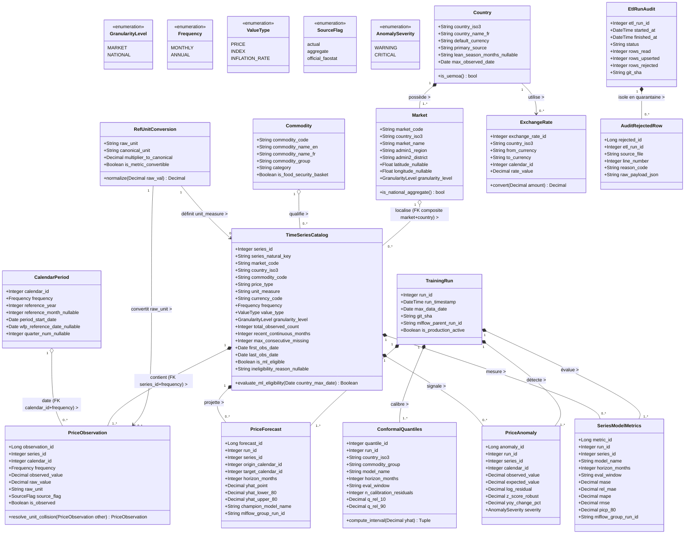

# Diagramme 03 — Diagramme de classes du domaine (*Domain Class Diagram*)

> **Termes techniques introduits dans ce document (en une phrase simple)** :
> - **Diagramme de classes du domaine (*Domain Class Diagram*)** : Un schéma UML qui représente les concepts métier du projet, leurs attributs typés, leurs opérations et leurs relations (`1` à `*`), aligné avec le modèle de données de l'entrepôt.
> - **Objet de valeur / Référentiel (`RefUnitConversion`)** : Une classe qui encapsule la règle de conversion d'une unité brute vers une unité canonique uniquement lorsque l'unité est métrique (`is_metric_convertible = True`).
> - **Entité de traçabilité d'exécution (`TrainingRun`, `EtlRunAudit`)** : Une classe qui scelle le contexte exact d'un traitement batch (date maximale des données, commit Git `git_sha`, identifiant MLflow) pour garantir la reproductibilité scientifique.

---

## 1. Diagramme Mermaid (Rendu natif GitHub)

---

## 2. Comment lire ce diagramme ?

1. **L'alignement 1-pour-1 avec l'entrepôt de données** :
   - `PriceObservation` ne contient plus `reference_year` ni `reference_month` : elle est liée à `CalendarPeriod` et `TimeSeriesCatalog` via le couple `(calendar_id, frequency)` et `(series_id, frequency)`, et distingue `source_flag` (`actual`, `aggregate`, `official_faostat`) du booléen unifié `is_observed` (`True` / `False`).
2. **La gouvernance des exécutions (`TrainingRun` et `EtlRunAudit`)** :
   - À gauche en bas, `EtlRunAudit` agrège les lignes rejetées (`AuditRejectedRow`), y compris les éventuelles collisions de normalisation d'unité (`resolve_unit_collision`).
   - Au centre, `TrainingRun` regroupe de manière cohérente les quantiles conformes (`ConformalQuantiles`), les prévisions (`PriceForecast`), les anomalies (`PriceAnomaly`) et les métriques par série (`SeriesModelMetrics`).

---

## 3. Deux questions qu'un recruteur pourrait poser sur ce diagramme

### Question 1 : *« Pourquoi avoir remplacé le simple attribut `price_flag` par le couple `(source_flag, is_observed)` dans `PriceObservation` ? »*
> **Réponse conseillée** :
> « Parce que nos deux fournisseurs de données utilisent des conventions différentes : le PAM (WFP) utilise `actual` vs `aggregate`, tandis que FAOSTAT fournit les séries officielles marocaines (`official_faostat`). Si le code du pipeline ML filtrait naïvement sur `source_flag == 'actual'`, il exclurait par erreur l'IPC alimentaire du Maroc ! En introduisant le booléen métier `is_observed = True` (pour `actual` et `official_faostat`) et `False` (pour `aggregate`), tous les algorithmes en aval (calcul d'éligibilité, entraînement ML, détection d'anomalies) filtrent sur un prédicat unique `is_observed == True`, tout en conservant `source_flag` pour l'auditabilité. »

### Question 2 : *« Quel est le rôle de la classe `ConformalQuantiles` entre `TrainingRun` et `PriceForecast` ? »*
> **Réponse conseillée** :
> « Dans notre méthode de Prédiction Conforme (*Split Conformal Prediction*), les déciles d'erreur relative ($q_{\text{rel}, 10}$ et $q_{\text{rel}, 90}$) sont calibrés au niveau du **groupe `(country_iso3, commodity_group, model_name, horizon_months, eval_window)`** (soit 19 groupes $\times 3$ horizons), puis appliqués à chacune des 738 séries individuelles pour construire `[yhat_lower_80, yhat_upper_80]`. Persister l'objet `ConformalQuantiles` rattaché à `TrainingRun` permet d'inspecter directement la largeur relative du cône d'incertitude par pays, produit et horizon (par exemple comparer $[-7\%, +11\%]$ à $t+1$ contre $[-16\%, +24\%]$ à $t+6$) sans avoir à la recalculer à partir des prévisions individuelles. »
