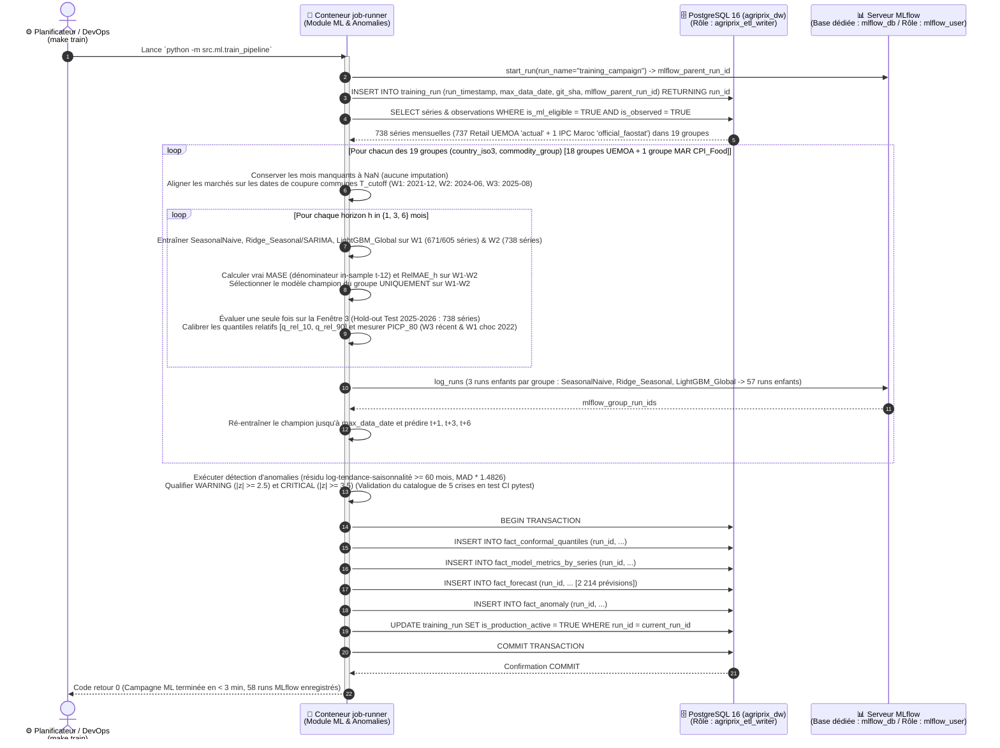
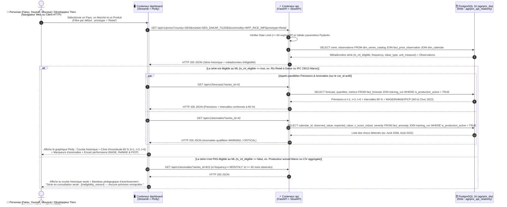

# Diagramme 04 — Diagrammes de séquence des 3 scénarios clés (*Sequence Diagrams*)

> **Termes techniques introduits dans ce document (en une phrase simple)** :
> - **Diagramme de séquence (*Sequence Diagram*)** : Un schéma UML chronologique (lu de haut en bas) qui montre l'ordre exact des appels entre les conteneurs du système.
> - **Isolation des bases et rôles SQL (`agriprix_dw` vs `mlflow_db`)** : Le fait d'héberger dans le serveur PostgreSQL deux bases de données logiquement séparées avec des utilisateurs dédiés afin que le serveur MLflow ne puisse ni lire ni modifier ni encombrer les tables métier de l'entrepôt.

---

## 1. Scénario 1 — Exécution du pipeline ETL avec contrôle d'intégrité anti-troncature HDX et normalisation `ref_unit_conversion`

```mermaid
sequenceDiagram
    autonumber
    actor DevOps as ⏰ Planificateur / DevOps<br/>(make etl)
    participant Runner as 🐍 Conteneur job-runner<br/>(ETL Python)
    participant HDX as 🌐 API CKAN & Serveur HDX<br/>(data.humdata.org)
    participant FAO as 🌐 Bulk Server FAOSTAT<br/>(bulks-faostat.fao.org)
    participant DB as 🗄️ PostgreSQL 16 (agriprix_dw)<br/>(Rôle : agriprix_etl_writer)

    DevOps->>Runner: Lance `python -m src.etl.run_pipeline`
    activate Runner
    Runner->>DB: INSERT INTO etl_run_audit (started_at, status='RUNNING', git_sha)

    loop Pour chacun des 5 pays UEMOA (SEN, MLI, BFA, NER, CIV)
        Runner->>HDX: GET /api/3/action/package_show?id=wfp-food-prices-for-{iso3}
        HDX-->>Runner: JSON Métadonnées (resource_url, expected_size, md5_hash, fs_check_info)
        Runner->>Runner: Pause polie (sleep 2s anti-WAF)
        Runner->>HDX: GET {resource_url} (Téléchargement flux CSV)
        alt Passerelle DQ-01 (HTTP 202 WAF) ou DQ-02 (size != expected_size ou MD5/lignes invalides)
            HDX-->>Runner: Flux incomplet (ex. NER tronqué à 57k lignes au lieu de 68.7k)
            Runner->>Runner: Rejet immédiat du fichier corrompu + Backoff exponentiel (5s, 15s)
            Runner->>HDX: Nouvelle tentative GET {resource_url}
            HDX-->>Runner: HTTP 200 CSV complet (taille, MD5 et lignes conformes)
        else Téléchargement intègre dès le 1er essai
            HDX-->>Runner: HTTP 200 CSV complet (taille, MD5 et lignes conformes)
        end
    end

    Runner->>FAO: GET ConsumerPriceIndices_E_Africa_NOFLAG.zip & Prices_E_Africa_NOFLAG.zip
    FAO-->>Runner: Archives ZIP intègres (Filtrage Area = Morocco)

    Runner->>Runner: Dépivotage FAOSTAT + Application ref_unit_conversion (métriques -> KG/L ; locales non converties)<br/>Qualification source_flag ('actual', 'official_faostat', 'aggregate') & is_observed (TRUE/FALSE)
    Runner->>Runner: Déduplication sur (series_id, calendar_id, source_flag) + Résolution collision unité (priorité unité native)<br/>Calcul is_ml_eligible (sur is_observed=TRUE, fraîcheur <= 3m, >= 60m continus sans imputer -> 738 séries)

    Runner->>DB: BEGIN TRANSACTION
    Runner->>DB: UPSERT dim_country, dim_market, dim_commodity, ref_unit_conversion, dim_calendar, dim_series_catalog
    Runner->>DB: UPSERT fact_price_observation (ON CONFLICT (series_id, calendar_id, source_flag) DO UPDATE)
    Runner->>DB: INSERT INTO audit_rejected_rows & UPDATE etl_run_audit (status='SUCCESS')
    Runner->>DB: COMMIT TRANSACTION
    DB-->>Runner: Confirmation (333 924 observations synchronisées, 0 doublon)

    Runner-->>DevOps: Code retour 0 + Rapport JSON (data/reports/etl_quality_report.json)
    deactivate Runner
```

---

## 2. Scénario 2 — Entraînement global (Sélection sur Fenêtres 1–2, Test final sur Fenêtre 3) et publication versionnée (`training_run`)



---

## 3. Scénario 3 — Consultation interactive par un utilisateur ou un développeur tiers (`Streamlit / Client API` $\rightarrow$ `FastAPI` $\rightarrow$ `PostgreSQL Lecture Seule`)



---

## 4. Comment lire ces diagrammes ?

1. **Dans le Scénario 2 (étape 4)**, la requête filtre sur `WHERE is_ml_eligible = TRUE AND is_observed = TRUE` : grâce au booléen `is_observed`, les 737 séries `actual` UEMOA **et** la série `official_faostat` de l'IPC Alimentaire du Maroc sont récupérées ensemble sans exclusion accidentelle.
2. **Dans le Scénario 2 (étapes 3 et 12–18)**, toutes les insertions analytiques se font sous un nouvel identifiant `run_id` de la table `training_run`, qui ne bascule à `is_production_active = TRUE` qu'à la toute fin de la transaction SQL (`COMMIT`). Pendant les 2 à 3 minutes que dure l'entraînement, l'API continue donc de servir l'ancien `run_id` sans aucune coupure ni lecture partielle (*Zero-Downtime Model Refresh*).

---

## 5. Deux questions qu'un recruteur pourrait poser sur ces séquences

### Question 1 : *« Dans le Scénario 2, que s'est-il passé lorsque vous aviez initialement écrit `WHERE price_flag = 'actual'` et comment l'avez-vous corrigé ? »*
> **Réponse conseillée** :
> « C'était un bug subtil de conception multi-sources : dans les fichiers WFP d'Afrique de l'Ouest, les vraies observations portent le drapeau `actual`, mais dans FAOSTAT pour le Maroc, elles portent le drapeau `official_faostat`. Filtrer sur `price_flag = 'actual'` éliminait silencieusement l'IPC alimentaire du Maroc lors de l'entraînement ! Nous avons donc remplacé `price_flag` par le couple `(source_flag, is_observed)` où `is_observed = TRUE` pour `actual` et `official_faostat` (et `FALSE` pour `aggregate`). Le pipeline ML filtre désormais sur `WHERE is_ml_eligible = TRUE AND is_observed = TRUE`, ce qui sélectionne exactement nos 738 séries (737 UEMOA + 1 Maroc). »

### Question 2 : *« Comment fonctionne la bascule atomique `is_production_active = TRUE` sur la table `training_run` entre le Scénario 2 et le Scénario 3 ? »*
> **Réponse conseillée** :
> « Au lieu d'écraser en place les prévisions existantes pendant que des utilisateurs consultent l'API, chaque exécution de `make train` insère ses nouvelles prévisions, anomalies, quantiles conformes et métriques avec un nouveau `run_id` (en gardant `is_production_active = FALSE` pendant les calculs). Une fois que les 19 groupes sont entraînés et que les anomalies sont calculées, une transaction atomique passe l'ancien run à `FALSE` et le nouveau `run_id` à `TRUE` (tandis que la non-régression du détecteur sur le catalogue de 5 crises historiques 2008–2023 est garantie en amont par les tests automatiques de la CI). L'API FastAPI joint `training_run WHERE is_production_active = TRUE` : la bascule est instantanée et permet de revenir en arrière (*rollback*) en une seconde si besoin. »
