# Diagramme 05 — Diagramme d'activité du pipeline de bout en bout (*Pipeline Activity Diagram*)

> **Termes techniques introduits dans ce document (en une phrase simple)** :
> - **Diagramme d'activité (*Activity Diagram*)** : Un schéma UML représentant le flux de contrôle et de données d'un pipeline automatisé, strictement aligné ici avec nos processus BPMN.
> - **Gestion native des `NaN` (*Missing Value Handling*)** : La capacité d'un algorithme d'arbres de décision comme LightGBM à orienter directement une valeur manquante (`NaN`) vers la branche gauche ou droite qui minimise la perte lors de l'entraînement, évitant toute imputation artificielle.

---

## 1. Diagramme Mermaid (Rendu natif GitHub — Aligné sur le BPMN)

```mermaid
flowchart TD
    StartNode(["🟢 DÉBUT DU PIPELINE MENSUEL<br/>(make etl && make train)"])

    subgraph Phase1_Extract ["PHASE A : Collecte & Contrôle d'Intégrité à 2 Passerelles (Aligné BPMN)"]
        A1["Interroger API CKAN HDX (5 pays UEMOA)<br/>Lire expected_size, md5_hash et fs_check_info (nb lignes)"]
        A2["Télécharger les 5 CSV WFP (délai poli 2s)<br/>+ 2 ZIP FAOSTAT Maroc (CP mensuel & PP annuel)"]
        A3{"Passerelle 1 (DQ-01) :<br/>HTTP 200 ET Content-Length > 0<br/>(Pas de challenge WAF HTTP 202) ?"}
        A4{"Passerelle 2 (DQ-02) :<br/>Taille octets == expected_size<br/>ET MD5 valide ET nb lignes complet ?"}
        A5["Retry avec Backoff exponentiel (max 3x)<br/>Si échec après 3 essais : Arrêt immédiat (Exit Code 1)"]
    end

    subgraph Phase2_Transform ["PHASE B : Harmonisation, ref_unit_conversion & Déduplication"]
        B1["Dépivoter FAOSTAT Maroc :<br/>- CP (Item 23013) -> frequency='MONTHLY', value_type='INDEX', source_flag='official_faostat', is_observed=TRUE<br/>- PP (Producteurs) -> frequency='ANNUAL', calendar_id=YYYY00 (reference_month=NULL)"]
        B2["Appliquer ref_unit_conversion sur WFP UEMOA :<br/>- Unités métriques (KG, 100 KG, 500 G, 70 G, L) -> converties en KG ou L<br/>- Unités locales / non-pondérales (Pile, Head, Day, Unit) -> NON converties<br/>- Qualifier source_flag ('actual' -> is_observed=TRUE ; 'aggregate' -> is_observed=FALSE)"]
        B3["Filtrer valeurs aberrantes techniques (observed_value <= 0, dates/GPS invalides)<br/>-> Isoler dans audit_rejected_rows (< 1 %)"]
        B4["Dédupliquer sur (series_id, calendar_id, source_flag)<br/>En cas de collision après normalisation d'unité :<br/>Priorité à l'unité canonique native (raw_unit == canonical_unit), doublon vers audit_rejected_rows"]
    end

    subgraph Phase3_Eligibility ["PHASE C : Qualification d'Éligibilité ML (Sans Imputation des Trous)"]
        C1["Regrouper les observations par Série Canonique (~2 100 séries)<br/>Calculer max_date(country) sur les lignes is_observed = TRUE"]
        C2{"1. Fréquence == 'MONTHLY'<br/>(Exclut les 367 séries ANNUAL du Maroc) ?"}
        C3{"2. Observation réelle : is_observed == TRUE<br/>(Inclut 'actual' WFP et 'official_faostat' Maroc ;<br/>Exclut les 4 054 lignes 'aggregate' CIV) ?"}
        C4{"3. Périmètre métier :<br/>Panier sécurité alimentaire (Riz, Mil, Sorgho, Maïs, Niébé)<br/>ET pricetype == 'Retail' (ou IPC 23013 Maroc) ?"}
        C5{"4. Fraîcheur relative :<br/>last_obs_date >= max_date(country) - 3 mois ?"}
        C6{"5. Continuité récente :<br/>Segment continu >= 60 mois<br/>avec <= 3 mois manquants consécutifs (laissés à NaN) ?"}

        MarkIneligible["Marquer is_ml_eligible = FALSE + ineligibility_reason<br/>(Série conservée en consultation historique seule)"]
        MarkEligible["Marquer is_ml_eligible = TRUE<br/>Résultat exact : 738 séries éligibles dans 19 groupes<br/>(737 Retail UEMOA dans 18 groupes + 1 IPC Maroc)"]
    end

    subgraph Phase4_ML_Anomalies ["PHASE D : Synchronisation SQL & Campagne Analytique Versionnée (training_run)"]
        ForkBar["=== Upsert PostgreSQL (333 924 obs + etl_run_audit) & Création training_run (run_id, git_sha) ==="]
        
        subgraph BranchAnom ["Branche 1 : Détection d'Anomalies (Séries MONTHLY, is_observed=TRUE, >= 60 mois)"]
            D1["Calculer sur log-prix L_t = ln(P_t) la valeur attendue unique :<br/>P_expected_t = exp(T_tilde_t + S_tilde_m)<br/>où T_tilde_t = median(L_{t-12}..L_{t-1}) et S_tilde_m = median saisonnière du mois m"]
            D2["Calculer résidu r_t = ln(P_t) - ln(P_expected_t)<br/>et Z-score robuste z_t = r_t / max(1.4826 * MAD_m, 0.02)"]
            D3["Qualifier WARNING (|z| >= 2.5) et CRITICAL (|z| >= 3.5)<br/>Upsert dans fact_anomaly (UNIQUE run_id, series_id, calendar_id)<br/>(Note : validation de rappel sur les 5 crises historiques 2008..2023 en test CI pytest)"]
        end

        subgraph BranchML ["Branche 2 : Prévisions Multi-Horizons (738 séries dans 19 groupes, Trous laissés à NaN)"]
            E1["Extraire segment continu récent (60 à 120 mois post-2015)<br/>NE PAS imputer les mois manquants (laisser NaN)"]
            E2["Découper par Date de Coupure Calendaire Commune T_cutoff :<br/>- Fenêtres de Validation W1 (Choc 2022 : 671 séries >=24m / 605 >=36m) & W2 (2024-2025 : 738 séries)<br/>- Fenêtre de Test Final Hold-out W3 (2025-2026 : 738 séries)"]
            E3["Entraîner pour h in {1, 3, 6} sur les 19 groupes :<br/>SeasonalNaive (t-12), Ridge_Seasonal / SARIMA, LightGBM_Global<br/>Sélectionner le modèle champion UNIQUEMENT sur les Fenêtres 1 et 2 (RelMAE_h < 1.0 & MASE)"]
            E4["Évaluer le rapport final hors-échantillon sur la Fenêtre 3 (2025-2026)<br/>Calibrer Split Conformal Prediction sur erreurs relatives par (country, commodity_group, h)<br/>Mesurer PICP_80 sur W3 (récent) et sur W1 (choc 2022)"]
            E5["Logger 57 runs MLflow (19 groupes x 3 familles) + 1 run parent = 58 runs dans mlflow_db"]
            E6["Sauvegarder avec run_id dans fact_conformal_quantiles,<br/>fact_model_metrics_by_series et fact_forecast (2 214 prévisions futures)"]
        end
    end

    EndNode(["🏁 FIN DU PIPELINE : Entrepôt agriprix_dw, mlflow_db et API à jour"])

    %% Liaisons
    StartNode --> A1 --> A2 --> A3
    A3 -- "Non (HTTP 202 WAF / Vide)" --> A5
    A3 -- "Oui" --> A4
    A4 -- "Non (Tronqué / MD5 / Lignes)" --> A5
    A5 -. "Nouvel essai" .-> A2
    A4 -- "Oui (100% Intègre)" --> B1 --> B2 --> B3 --> B4 --> C1 --> C2

    C2 -- "Non (ANNUAL)" --> MarkIneligible
    C2 -- "Oui" --> C3
    C3 -- "Non (is_observed=FALSE / aggregate)" --> MarkIneligible
    C3 -- "Oui" --> C4
    C4 -- "Non (Wholesale / Hors panier)" --> MarkIneligible
    C4 -- "Oui" --> C5
    C5 -- "Non (Série arrêtée > 3 mois)" --> MarkIneligible
    C5 -- "Oui" --> C6
    C6 -- "Non (< 60 mois continus ou trou > 3 mois)" --> MarkIneligible
    C6 -- "Oui" --> MarkEligible

    MarkIneligible --> ForkBar
    MarkEligible --> ForkBar

    ForkBar --> D1 --> D2 --> D3 --> EndNode
    ForkBar --> E1 --> E2 --> E3 --> E4 --> E5 --> E6 --> EndNode
```

---

## 2. Comment lire ce diagramme ?

1. **La `PHASE A`** est désormais strictement alignée avec le BPMN : elle distingue la **Passerelle 1 (`DQ-01` : statut HTTP 200 et absence de challenge WAF)** et la **Passerelle 2 (`DQ-02` : taille exacte en octets, hash MD5 et nombre de lignes)**.
2. **Dans la `PHASE C`**, le filtre `C3` utilise `is_observed == TRUE`, ce qui retient à la fois les relevés `actual` d'Afrique de l'Ouest et l'indice officiel `official_faostat` du Maroc, tout en écartant les estimations `aggregate`.
3. **Dans la `PHASE D`**, la **Branche 1** calcule les anomalies en production tandis que la validation sur le catalogue de chocs historiques fixés *a priori* (`2008`, `2012`, `2020`, `2022`, `2023–2024`) est exécutée dans la suite de tests automatiques de la CI (`pytest`), et la **Branche 2** conserve les trous à `NaN` (`E1`), choisit le modèle champion sur les Fenêtres 1–2 (`E3`) et produit le rapport final sur la Fenêtre 3 (`E4`).

---

## 3. Deux questions qu'un recruteur pourrait poser sur ce diagramme

### Question 1 : *« Dans la Phase D (`E2`), pourquoi le nombre de séries testables est-il de 671 (ou 605) sur la Fenêtre 1 (Choc 2022) contre 738 sur les Fenêtres 2 et 3 ? »*
> **Réponse conseillée** :
> « Parce que l'éligibilité actuelle de nos 738 séries exige un segment continu d'au moins 60 mois (5 ans) avant août/septembre 2026, c'est-à-dire démarrant au plus tard à l'été 2021. Or, pour tester un modèle sur l'année 2022 (Fenêtre 1, coupure fin décembre 2021), la série doit déjà disposer d'au moins 24 mois d'historique continu *avant* décembre 2021 (12 mois pour construire le décalage saisonnier `lag_12` + au moins 12 mois d'apprentissage, soit un démarrage avant fin 2019). Sur nos 738 séries éligibles, **671 séries** (réparties dans 18 groupes sur 19) démarrent avant fin 2019 et sont testables sur le choc de 2022 (et **605 séries** si l'on exige 36 mois avant fin 2021), tandis que les 67 séries démarrées entre début 2020 et mi-2021 (comme les 8 séries de Niébé au Sénégal ouvertes en juillet 2020) rejoignent le backtesting dès la Fenêtre 2 (`2024–2025`, **738 séries sur 738**) et la Fenêtre 3 (`2025–2026`, **738 séries sur 738**). »

### Question 2 : *« Pourquoi la validation du détecteur d'anomalies sur les chocs historiques (`2008`, `2012`, `2020`, `2022`, `2023–2024`) est-elle placée dans un test automatique de la CI (`pytest`) plutôt que comme porte bloquante dans le pipeline mensuel de production ? »*
> **Réponse conseillée** :
> « Parce qu'en production mensuelle, les observations historiques de 2008, 2012 ou 2022 sont figées : elles ne changent que si un développeur modifie le code de l'algorithme ou les seuils du détecteur. Placer cette vérification dans la suite de tests automatiques de la CI (`make test` / GitHub Actions) permet de bloquer dès la *Pull Request* toute modification du code qui dégraderait le rappel événement par événement sur notre catalogue de chocs de référence ($\ge 80\%$ requis), sans alourdir ni risquer de bloquer artificiellement le job mensuel de production. »
