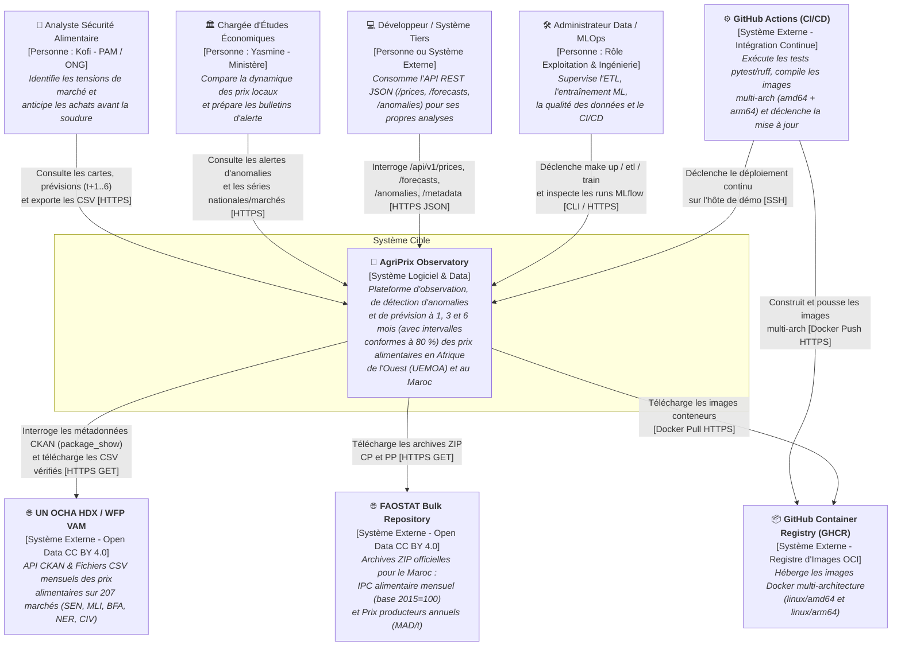
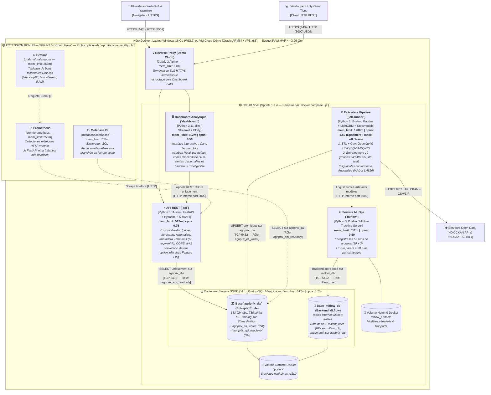

# Diagramme 07 — Architecture C4 : Contexte et Conteneurs (*C4 Model*)

> **Termes techniques introduits dans ce document (en une phrase simple)** :
> - **Modèle C4 (*Context, Containers, Components, Code*)** : Une méthode de schématisation d'architecture logicielle créée par Simon Brown qui présente le système par niveaux de zoom successifs (C1 : Contexte global ; C2 : Conteneurs déployables).
> - **Cloisonnement multi-bases PostgreSQL (`agriprix_dw` vs `mlflow_db`)** : La séparation logique au sein d'un même serveur PostgreSQL entre la base de l'entrepôt métier (`agriprix_dw`) et la base interne de suivi MLOps (`mlflow_db`), chacune disposant de ses propres rôles et permissions SQL.

---

## 1. Niveau C1 — Diagramme de Contexte Système (*System Context*)

---

## 2. Niveau C2 — Diagramme des Conteneurs (*Container Diagram* : Cœur MVP vs Bonus Sprint 5)

---

## 3. Récapitulatif du Budget Ressources et du Cloisonnement SQL

| Conteneur | Périmètre | Image de base | Limite RAM | Limite CPU | Base & Rôle SQL utilisés |
| :--- | :---: | :--- | :---: | :---: | :--- |
| `db` | **MVP (S1)** | `postgres:16-alpine` | `512 Mo` | `0.75` | Héberge 2 bases isolées : `agriprix_dw` et `mlflow_db` |
| `mlflow` | **MVP (S2)** | `python:3.11-slim` | `512 Mo` | `0.50` | Base `mlflow_db` uniquement via le rôle `mlflow_user` |
| `api` | **MVP (S3)** | `python:3.11-slim` | `512 Mo` | `0.75` | Base `agriprix_dw` uniquement via `agriprix_api_readonly` (`SELECT`) |
| `dashboard` | **MVP (S4)** | `python:3.11-slim` | `512 Mo` | `0.50` | **Aucun accès SQL** (passe à 100 % par `api` HTTP) |
| `job-runner` | **MVP (S1–S3)** | `python:3.11-slim` | `1 280 Mo` | `1.50` | Base `agriprix_dw` via `agriprix_etl_writer` (`SELECT/INSERT/UPDATE`) |
| **TOTAL MVP** | **Sprints 1 à 4** | — | **2 048 Mo repos / 3 328 Mo pic** | **2.50 à 4.00** | **Strictement sous la barre des 4 Go de RAM** |

---

## 4. Comment lire ces diagrammes ?

1. **Sur le Niveau C1 (Contexte)** :
   - Les personnes sont représentées par leur **rôle fonctionnel** (`Analyste`, `Chargée d'Études`, `Développeur / Système Tiers`, `Administrateur Data / MLOps`).
   - Les flèches respectent le sens d'appel réseau : `GitHub Actions` pousse (`docker push`) vers `GHCR`, tandis qu'`AgriPrix Observatory` tire (`docker pull`) les images depuis `GHCR`.
2. **Sur le Niveau C2 (Conteneurs)** :
   - Zoomez sur le conteneur `db` : au lieu de mélanger les tables métier de l'entrepôt et les tables internes d'alembic/MLflow dans une seule base, le script d'initialisation `/docker-entrypoint-initdb.d/01-init.sql` crée **deux bases de données distinctes** (`agriprix_dw` et `mlflow_db`) et **trois rôles cloisonnés** (`agriprix_etl_writer`, `agriprix_api_readonly`, `mlflow_user`), tout en mutualisant le même processus `postgres:16-alpine` de `512 Mo` pour économiser la RAM.

---

## 5. Deux questions qu'un recruteur pourrait poser sur cette architecture C4

### Question 1 : *« Pourquoi avoir créé deux bases de données séparées (`agriprix_dw` et `mlflow_db`) avec trois rôles SQL distincts à l'intérieur du même conteneur PostgreSQL ? »*
> **Réponse conseillée** :
> « Lancer deux conteneurs PostgreSQL distincts aurait doublé la consommation mémoire de la base de données (`2 x 512 Mo`), alors que créer deux bases logiques (`CREATE DATABASE agriprix_dw` et `CREATE DATABASE mlflow_db`) au sein de la même instance `postgres:16-alpine` ne coûte quasiment aucun octet de RAM supplémentaire. En revanche, sur le plan de la sécurité et de la propreté du schéma, cette séparation est essentielle : MLflow crée automatiquement une quinzaine de tables techniques (`experiments`, `runs`, `metrics`, `alembic_version`) et exécute des migrations de schéma. En isolant MLflow dans `mlflow_db` avec son propre utilisateur `mlflow_user`, il ne pollue pas l'entrepôt en étoile `agriprix_dw` et ne possède aucun droit de lecture ou d'écriture sur les données métier. »

### Question 2 : *« Sur le diagramme C1, pourquoi la flèche entre AgriPrix Observatory et GitHub Container Registry (GHCR) part-elle d'AgriPrix vers GHCR ? »*
> **Réponse conseillée** :
> « Parce qu'en modélisation C4, le sens d'une flèche indique qui initie la requête ou la dépendance réseau. Un registre de conteneurs comme GHCR est un serveur de stockage passif : il ne se connecte jamais de lui-même à notre machine virtuelle. C'est `GitHub Actions` qui initie un `HTTPS POST/PUT (docker push)` vers `GHCR`, puis déclenche par `SSH` la commande `docker compose pull` sur l'hôte `AgriPrix Observatory`, lequel initie alors une requête sortante `HTTPS GET (docker pull)` vers `GHCR`. »
