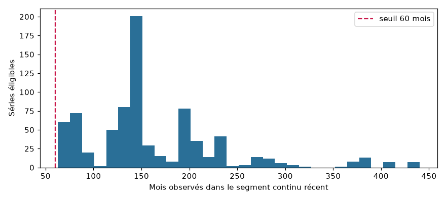
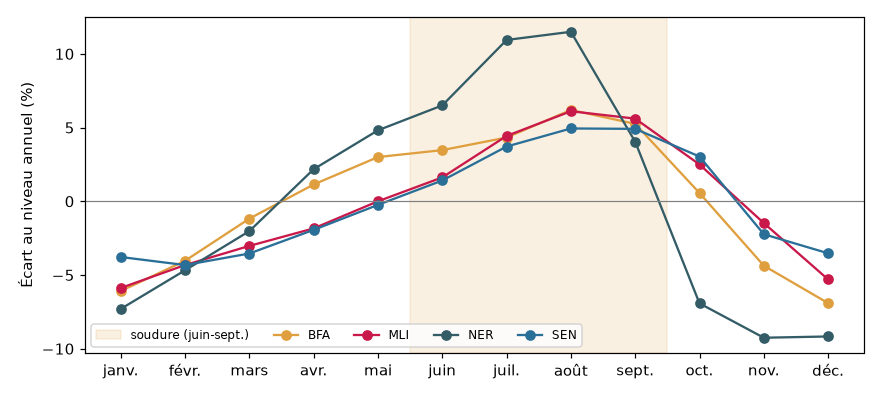
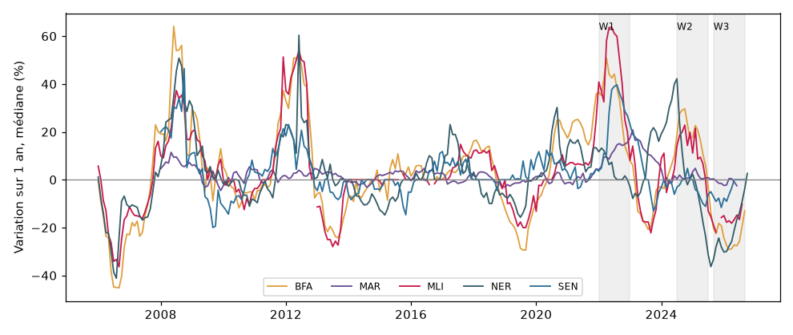

# Analyse exploratoire des séries éligibles (EDA)

> Rapport **généré automatiquement** le 2026-11-10 par `python -m src.eda.report`, à partir de l'entrepôt (exécution ETL `etl_run_id = 5`). Tous les chiffres viennent de cette exécution ; les commentaires sont déduits de ces chiffres.

## 1. Périmètre

**782 séries éligibles**, 147 757 observations mensuelles réellement observées (aucune valeur interpolée).

| commodity_group | BFA | MAR | MLI | NER | SEN |
|---|---|---|---|---|---|
| Beans | 59 | 0 | 0 | 0 | 7 |
| CPI_Food | 0 | 1 | 0 | 0 | 0 |
| Maize | 50 | 0 | 50 | 45 | 8 |
| Millet | 56 | 0 | 62 | 50 | 7 |
| Rice | 58 | 0 | 96 | 55 | 18 |
| Sorghum | 55 | 0 | 56 | 46 | 3 |

## 2. Continuité des séries et seuil de 60 mois

- Segment continu récent : médiane **141 mois**, minimum 63 (le seuil de 60 est respecté par construction).
- Plus long trou toléré dans le segment : 0 mois → 149 séries, 1 mois → 261 séries, 2 mois → 187 séries, 3 mois → 185 séries. Ces mois manquants restent vides : les modèles reçoivent des `NaN`, jamais une valeur inventée.
- Pourquoi 60 mois : 12 mois de retards saisonniers (`lag_12`) + au moins 24 mois d'entraînement + 12 mois de validation + 12 mois de test (voir `docs/02-sources-donnees.md` §5.2).

## 3. Saisonnalité agricole (céréales sèches)

Écart médian de chaque mois au niveau moyen centré sur 12 mois (mil, sorgho, maïs) :

| month | BFA | MLI | NER | SEN |
|---|---|---|---|---|
| janv. | -6.1 | -5.9 | -7.3 | -3.8 |
| févr. | -4.0 | -4.3 | -4.7 | -4.3 |
| mars | -1.2 | -3.0 | -2.0 | -3.5 |
| avr. | 1.1 | -1.8 | 2.2 | -1.9 |
| mai | 3.0 | 0.0 | 4.8 | -0.2 |
| juin | 3.5 | 1.6 | 6.5 | 1.4 |
| juil. | 4.3 | 4.4 | 10.9 | 3.7 |
| août | 6.2 | 6.1 | 11.5 | 4.9 |
| sept. | 5.3 | 5.6 | 4.0 | 4.9 |
| oct. | 0.6 | 2.5 | -6.9 | 3.0 |
| nov. | -4.4 | -1.5 | -9.3 | -2.2 |
| déc. | -6.9 | -5.3 | -9.2 | -3.5 |

- **BFA** : pic en **août** ; juin–sept. en moyenne +4.8 % contre -3.6 % en oct.–déc. → la hausse pendant la soudure est visible.
- **MLI** : pic en **août** ; juin–sept. en moyenne +4.4 % contre -1.4 % en oct.–déc. → la hausse pendant la soudure est visible.
- **NER** : pic en **août** ; juin–sept. en moyenne +8.2 % contre -8.4 % en oct.–déc. → la hausse pendant la soudure est visible.
- **SEN** : pic en **août** ; juin–sept. en moyenne +3.7 % contre -0.9 % en oct.–déc. → la hausse pendant la soudure est visible.

**Conséquence pour la modélisation** : le mois cible, l'indicateur de soudure et le prix du même mois l'an passé (`seasonal_level`, `seasonal_change`) font partie des variables explicatives.

## 4. Stationnarité

Test de Dickey-Fuller augmenté (ADF : il teste si une série « dérive » sans revenir vers une moyenne) sur 261 séries échantillonnées : l'hypothèse de racine unitaire est rejetée à 5 % pour **27%** des séries en log-niveau, contre **97%** en variations mensuelles.

**Conséquence** : les modèles prédisent la **variation logarithmique** entre le dernier prix connu et le prix à l'horizon h, et non le niveau. Cela rend aussi comparables des marchés aux niveaux de prix très différents, condition pour entraîner un modèle global par (pays, produit).

## 5. Dynamique des prix et régimes des fenêtres d'évaluation

Médiane des variations sur 1 an (%) par pays et par fenêtre :

| country_iso3 | 2022 (W1) | 2024-07→2025-06 (W2) | 2025-09→2026-08 (W3) |
|---|---|---|---|
| BFA | 37.4 | 19.6 | -25.1 |
| MAR | 11.7 | 0.7 | -1.2 |
| MLI | 45.4 | 14.2 | -16.7 |
| NER | 4.0 | -0.3 | -26.8 |
| SEN | 28.3 | -2.7 | -6.7 |

- **Retournement de marché** pour BFA, MLI : les prix montaient pendant la fenêtre de calibration W2 et baissent nettement pendant la fenêtre de test W3.
- **Forte baisse en W3** pour NER après une période stable en W2.
- Les intervalles conformes supposent que les erreurs futures ressemblent aux erreurs passées (échangeabilité) : ces changements de régime l'enfreignent, comme le choc de 2022.

## 6. Volatilité mensuelle

Écart-type médian des variations mensuelles du log-prix (%), par pays et produit :

| country_iso3 | Beans | CPI_Food | Maize | Millet | Rice | Sorghum |
|---|---|---|---|---|---|---|
| BFA | 11.2 |  | 8.1 | 8.8 | 4.5 | 8.5 |
| MAR |  | 1.4 |  |  |  |  |
| MLI |  |  | 10.2 | 7.6 | 4.0 | 8.0 |
| NER |  |  | 8.7 | 11.8 | 4.8 | 11.7 |
| SEN | 15.4 |  | 8.5 | 9.0 | 6.8 | 7.7 |

Les groupes les plus volatils sont ceux où un intervalle de 80 % sera le plus large.
